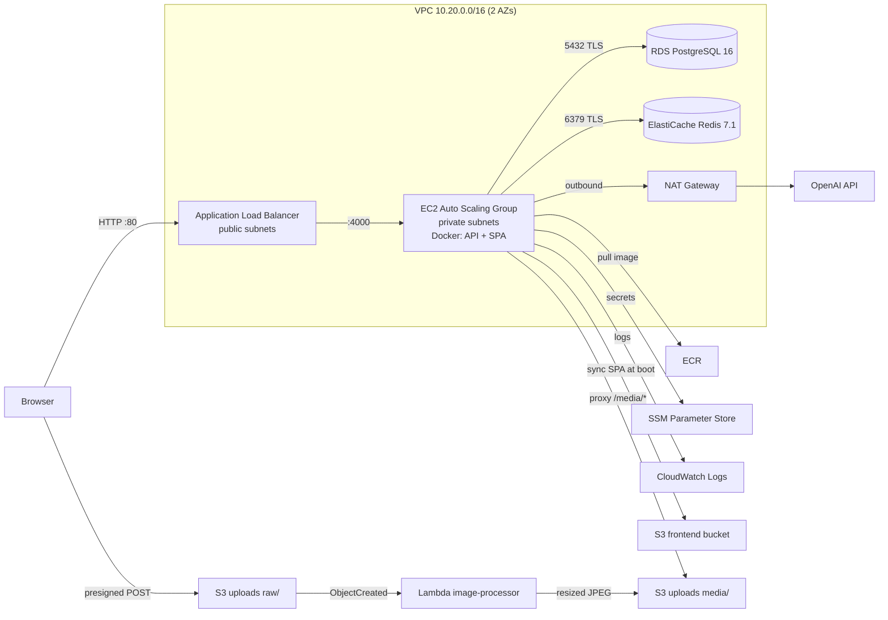
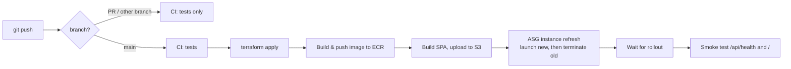

# DevMatch – Tinder for Developers

Developers swipe on each other and match on a **shared stack** (React ↔ React, Spring ↔ Spring) or **complementary roles** (frontend ↔ backend, data ↔ ML, designer ↔ frontend), then chat in real time.

**App:** React (Vite) · Express.js · PostgreSQL · Redis · WebSockets · OpenAI
**Infra:** Docker · Terraform · GitHub Actions · AWS (VPC, ALB, EC2 Auto Scaling, RDS, ElastiCache, S3, Lambda, ECR, SSM, CloudWatch, IAM OIDC)

## Features
- **Recommendations.** There are three modes: `similar`, `complementary` and `mixed` ([recommendations.js](backend/src/services/recommendations.js)). With an OpenAI key set, the top 25 results are re-ranked by an LLM, and the result is cached in Redis for 5 minutes.
- **Real-time chat.** Chat runs over WebSockets (`/ws`) with typing indicators and live match notifications. Redis pub/sub delivers messages across instances.
- **Profile cache.** `GET /api/profiles/:id` is cached in Redis for 60 seconds with `allkeys-lru` eviction. The `X-Cache` header reports `HIT` or `MISS`.
- **Avatar processing.** A Lambda downsizes uploaded profile pictures to 320 px at JPEG quality 55, then deletes the original.
- **Seed data.** 100 developer profiles plus demo accounts, matches and messages, loaded on first boot.

| Demo login | Password |
|---|---|
| `demo@devmatch.dev` (React frontend dev) | `DevMatch123!` |
| `backend@devmatch.dev` (Spring Boot backend dev) | `DevMatch123!` |

All seeded users (`*@seed.devmatch.dev`) share this password. About 40% of them have already liked the demo accounts, so liking them back creates a match right away.

## Repository layout
```
backend/                 Express API + WebSocket server (Node 20, ESM)
  src/routes/            auth, profiles, swipes, matches, uploads
  src/services/          recommendation engine + OpenAI re-ranking
  src/realtime.js        WebSocket chat over Redis pub/sub
frontend/                React SPA (Vite)
lambda/image-processor/  S3-triggered avatar downscaler (jimp)
infra/bootstrap/         One-time Terraform: state bucket + GitHub OIDC role
infra/terraform/         Main Terraform stack (all AWS resources)
.github/workflows/       ci.yml (tests) and deploy.yml (CD to AWS)
docker-compose.yml       Local stack
```

## Run locally
```bash
docker compose up --build            # http://localhost:8080
```
Add `OPENAI_API_KEY=sk-...` (and optionally `OPENAI_MODEL=gpt-4o-mini`) to a root `.env` file to turn on AI recommendations. The file is git-ignored.

For hot reload, run each in its own terminal:
```bash
docker compose up -d postgres redis
cd backend && npm install && npm run dev      # API on :4000
cd frontend && npm install && npm run dev     # UI on http://localhost:5173
```
There's no S3 locally, so avatar upload is disabled. Paste an image URL instead.

**Tests:** `cd backend && npm test` (the integration tests run when `DATABASE_URL` and `REDIS_URL` are set) and `cd lambda/image-processor && npm test`.

## AWS architecture



### How a request flows
1. The browser connects to the **ALB** on port 80. This is the only public entry point.
2. The ALB forwards the request to an **EC2** instance on port 4000. The instances sit in private subnets with no public IP. The ALB health-checks `/api/health`.
3. Each instance runs one Docker container, and that container serves everything:
   - `/api/*` is the REST API.
   - `/ws` is the WebSocket chat.
   - `/media/*` proxies processed avatars from S3.
   - Any other path is served by the React SPA.
4. The container talks to **RDS Postgres** and **ElastiCache Redis**, both over TLS and both reachable only from the app's security group.

### AWS services

| Service | Purpose |
|---|---|
| **VPC** | 2 AZs, with public subnets (ALB, NAT), private subnets (EC2, Redis) and database subnets (RDS) |
| **NAT Gateway** | Outbound internet for private instances (OpenAI, Docker packages) |
| **Security groups** | The chain internet → ALB:80 → app:4000 → RDS:5432 / Redis:6379, with nothing else open |
| **Application Load Balancer** | Public entry point and health checks. The 300 s idle timeout keeps WebSockets open |
| **EC2 + Auto Scaling** | t3.micro on Amazon Linux 2023, min 1 / max 2 instances, scaling on 60% CPU and self-healing via ELB health checks |
| **ECR** | Private Docker registry for the API image. Scans on push and keeps the last 20 images |
| **RDS PostgreSQL 16** | db.t4g.micro, encrypted, not publicly accessible, 1-day backups |
| **ElastiCache Redis 7.1** | Profile/recommendation cache and chat pub/sub. Encrypted at rest and in transit |
| **S3** | Terraform state, the built React app, and avatar uploads (`raw/` expires after 1 day, `media/` holds processed images). All buckets are private and encrypted |
| **Lambda** | Triggered by S3 `raw/` uploads. Resizes the image to `media/` and deletes the original |
| **SSM Parameter Store** | SecureString secrets: DB password, JWT secret, OpenAI key |
| **IAM + STS** | Least-privilege roles for EC2 and Lambda. GitHub Actions authenticates through OIDC, with no stored AWS keys |
| **CloudWatch** | Logs `/devmatch/prod/api` and `/aws/lambda/devmatch-prod-image-processor` (14 days), an ALB 5xx alarm, and CPU metrics for scaling |

### Instance boot sequence
The EC2 boot script ([user_data.sh.tpl](infra/terraform/templates/user_data.sh.tpl)) is rendered by Terraform. It:
1. Installs Docker and registers a `devmatch-api` systemd service with `Restart=always`.
2. Pulls `devmatch-prod-api:latest` from ECR.
3. Syncs the React build from the frontend S3 bucket.
4. Reads secrets from SSM into a root-only env file.
5. Starts the container with logs sent to CloudWatch. On first boot the API runs migrations and seeds the 100 profiles.

## Terraform

Terraform manages every AWS resource as code. There are two stacks.

**1. [infra/bootstrap](infra/bootstrap/main.tf).** Run this once, locally, with admin credentials. Its state is a local file and is git-ignored. It creates:
- An S3 bucket for remote state (versioned and encrypted, using S3-native locking).
- The GitHub OIDC identity provider.
- The IAM role `devmatch-github-actions`. Only workflows on `main` of this repo can assume it.

**2. [infra/terraform](infra/terraform).** The application stack. Its state is stored in S3 at `devmatch/prod.tfstate`.

| File | Contents |
|---|---|
| [main.tf](infra/terraform/main.tf) | Providers, S3 backend, default tags |
| [variables.tf](infra/terraform/variables.tf) | Instance sizes, ASG sizes, DB/Redis options, avatar settings |
| [network.tf](infra/terraform/network.tf) | VPC, subnets, NAT, security groups |
| [data.tf](infra/terraform/data.tf) | Generated secrets, SSM parameters, RDS, ElastiCache |
| [storage.tf](infra/terraform/storage.tf) | S3 buckets and policies, Lambda, S3 → Lambda trigger |
| [compute.tf](infra/terraform/compute.tf) | ECR, IAM, ALB, launch template, Auto Scaling group, alarms |
| [outputs.tf](infra/terraform/outputs.tf) | `app_url`, bucket names, endpoints, ASG name |

## CI/CD



- **[ci.yml](.github/workflows/ci.yml)** runs on PRs and non-`main` branches. It runs the backend tests against Postgres and Redis service containers, a Docker build, the frontend build, the Lambda tests, and `terraform fmt` + `validate`.
- **[deploy.yml](.github/workflows/deploy.yml)** runs on every push to `main` and can also be started manually. It:
  1. Runs CI.
  2. Authenticates to AWS through OIDC.
  3. Runs `terraform apply`.
  4. Pushes the API image (tagged with the commit SHA and `latest`) to ECR.
  5. Uploads the SPA to S3.
  6. Starts a zero-downtime instance refresh (min 100% / max 200% healthy).
  7. Waits for the refresh to finish and smoke-tests the live URL.

  A push typically goes live in about 6–8 minutes.

### GitHub configuration
Set these under **Settings → Secrets and variables → Actions**:

| Type | Name | Value |
|---|---|---|
| Variable | `AWS_REGION` | `us-east-1` |
| Variable | `AWS_ROLE_ARN` | bootstrap output `github_actions_role_arn` |
| Variable | `TF_STATE_BUCKET` | bootstrap output `tf_state_bucket` |
| Secret | `OPENAI_API_KEY` | your OpenAI key. Required, otherwise each deploy resets it to `CHANGE_ME` |

## First-time deployment
```bash
# 1. Bootstrap (once)
cd infra/bootstrap
terraform init
terraform apply -var="github_repo=<owner>/<repo>"
# add -var="create_oidc_provider=false" if the account already has the GitHub OIDC provider

# 2. Main stack
cd ../../lambda/image-processor && npm ci --omit=dev && cd -
cd ../terraform
terraform init -backend-config="bucket=<tf_state_bucket>" -backend-config="key=devmatch/prod.tfstate" \
  -backend-config="region=us-east-1" -backend-config="encrypt=true" -backend-config="use_lockfile=true"
export TF_VAR_openai_api_key="sk-..."
terraform apply

# 3. Add the GitHub variables/secret above, then push to main. CI/CD builds and deploys everything.
git push origin main
```
The first `terraform apply` takes about 15 minutes, mostly creating RDS and ElastiCache. When it finishes, `terraform output app_url` prints the site URL.

## Operations
- **Logs:** CloudWatch `/devmatch/prod/api` and `/aws/lambda/devmatch-prod-image-processor`.
- **Shell on an instance:** use SSM Session Manager. Instances have no SSH or public IP.
- **Rotate the OpenAI key:** update the GitHub secret and re-run Deploy.
- **Higher availability:** set `db_multi_az = true` and `redis_num_nodes = 2`, and raise `asg_min_size`.
- **Tear down:** run `terraform destroy` in `infra/terraform`. Keep `infra/bootstrap` so you can redeploy later with a push or `terraform apply`.

## Security notes
- The site is served over **plain HTTP**. Use demo accounts only, and add HTTPS (an ACM certificate on the ALB, or CloudFront) before handling real users.
- Secrets live only in SSM and the GitHub secret store. They never appear in code, images or Terraform files.
- The GitHub deploy role has `AdministratorAccess` so it can run Terraform. Scope it down for production accounts.

## Cost
The defaults are 1× t3.micro, db.t4g.micro, cache.t4g.micro, 1 NAT gateway and an ALB. They cost about **$90–100/month**, with the NAT gateway as the largest item. Destroy the stack when you're not using it.
